  
  
  

### <kbd>F1</kbd> About

I'm Timothy, a cyber security student in Jakarta. I write detection rules, run my own cloud infrastructure, and build backend services and small tools that take a step out of my day: a disk usage treemap, a converter for almost any file format, a script that moves VMware labs onto an isolated KVM network.

I'm also an AI enthusiast and keep up with the latest models, research and agent tooling as it lands. I benchmark models on real work, write custom skills for coding agents, and use AI wherever it makes security and engineering work faster.

I learn by building the thing before I fully understand it, breaking it, reading the docs, then rebuilding it properly. My Linux installs go through the same loop, which is why I keep three sets of dotfiles.

### <kbd>F2</kbd> Projects

| Project | What it does | Built with |
|---|---|---|
| [**oci-homelab**](https://github.com/timsurrealedu/oci-homelab) | A $0 Oracle Cloud platform built as code: Terraform network and firewalls, Ansible-hardened server, monitoring, live demos behind Caddy. | Terraform, Ansible, Python |
| [**nolen**](https://github.com/timsurrealedu/nolen) | Linux security telemetry that turns authenticated events into explainable detections and correlated incidents (I led detection engineering). | Node.js, NATS, MITRE ATT&CK |
| [**lab-import**](https://github.com/timsurrealedu/lab-import) | Imports VMware VMs into QEMU/KVM and wires them into an isolated pentest network through libvirt, treating every archive as untrusted. | Python, libvirt |
| [**sentinel**](https://github.com/timsurrealedu/sentinel) | Secret scanner as a GitHub Action, a CLI and a dashboard; stores masked findings only. | TypeScript, GitHub Actions |
| [**ctf-competition**](https://github.com/timsurrealedu/ctf-competition) | Agent Skill that keeps AI coding agents on track through long CTF challenges: hypotheses, memory and checkpoints on disk. | Claude Code, Codex |
| [**Slate**](https://github.com/timsurrealedu/Slate) | Offline Markdown notes and paged handwriting for Windows, Linux, Android and the web. | TypeScript, Bun |
| [**clearing**](https://github.com/timsurrealedu/clearing) | Disk usage analyzer that draws your drive as a treemap. | Rust |
| [**omniconvert**](https://github.com/timsurrealedu/omniconvert) | Converts between documents, spreadsheets, slides, PDFs, images, audio, and video by chaining the right tools. | Python |
| [**SmartWarga**](https://github.com/timsurrealedu/SmartWarga) | Management app for Indonesian neighborhood associations (RT/RW). | TypeScript |
| [**stewie**](https://github.com/timsurrealedu/stewie) | Turns tech topics into short vertical videos through an LLM fallback chain, TTS and ffmpeg, with manual approval before publishing. | Python, LLMs |

### <kbd>F3</kbd> Stack

### <kbd>F4</kbd> Activity

<picture>
  <source media="(prefers-color-scheme: dark)" srcset="https://raw.githubusercontent.com/timsurrealedu/timsurrealedu/output/snake-dark.svg" />
  <source media="(prefers-color-scheme: light)" srcset="https://raw.githubusercontent.com/timsurrealedu/timsurrealedu/output/snake-light.svg" />
  
</picture>

### <kbd>F5</kbd> Contact

  

